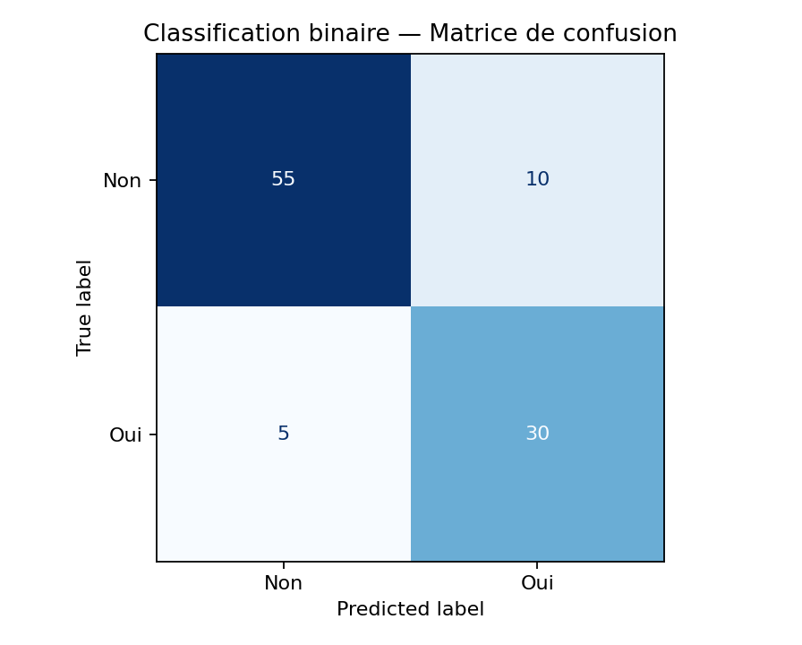
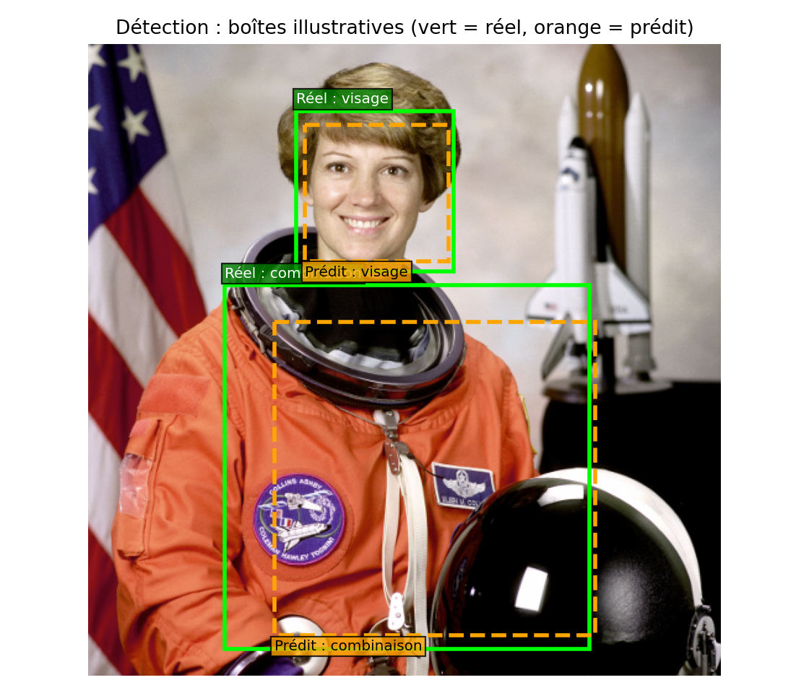
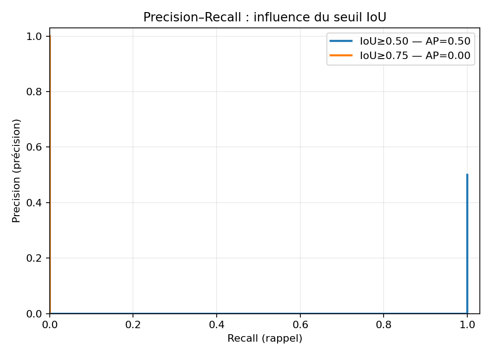
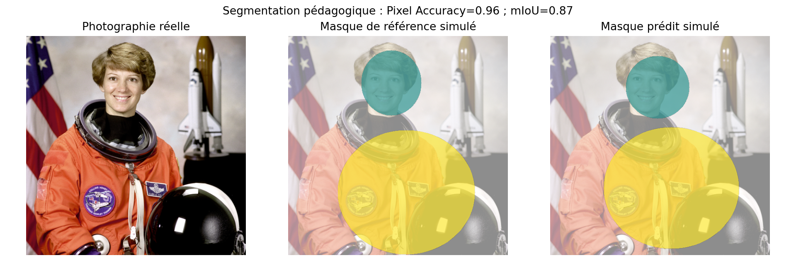
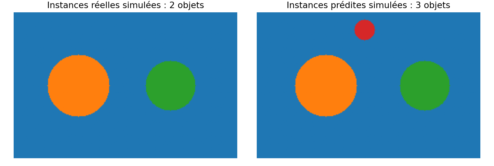

# Évaluation des modèles de Computer Vision

**Master Data & IA — Homework : Evaluation Metrics for Computer Vision Tasks**  
**Trois tâches étudiées :** classification d'images, détection d'objets, segmentation sémantique et d'instances.  
**Objectif :** expliquer, calculer et visualiser des métriques de performance avec des exemples Python *simples et reproductibles*.

> **Important — portée scientifique :** les étiquettes, boîtes de détection et masques ont été définis à des fins pédagogiques. Les scripts **n'entraînent pas de CNN, YOLO ou U-Net** et ne prétendent pas mesurer les performances d'un modèle réel. Certaines figures utilisent une photographie réelle fournie par `skimage.data.astronaut()`, mais les annotations superposées sont **simulées**, et les scores AP/mAP sont des implémentations simplifiées pour comprendre les principes, **pas** une évaluation officielle COCO. Cette distinction empêche de présenter des valeurs artificielles comme résultats expérimentaux.

## 1. Organisation du dépôt

```text
Evaluation_CV_GitHub/
├── README.md                             # Documentation, méthode et résultats
├── requirements.txt                      # Bibliothèques nécessaires
├── run_all.py                            # Lance les trois exemples
├── .gitignore
├── .github/workflows/tests.yml          # Vérification automatisée sur GitHub Actions
├── examples/
│   ├── classification_metrics.py         # Binaire, multiclasse, multilabel, hiérarchique
│   ├── detection_metrics.py              # Box IoU, Precision/Recall, AP/mAP didactiques
│   └── segmentation_metrics.py           # Pixel Accuracy, IoU, Dice, mIoU, Mask AP
├── figures/
│   ├── classification_binaire_confusion.png
│   ├── classification_multiclasse_confusion.png
│   ├── detection_iou_photo_reelle.png
│   ├── detection_precision_recall.png
│   ├── segmentation_masques_photo_reelle.png
│   └── segmentation_instances_mask_ap.png
├── notebooks/
│   └── TP_Evaluation_Computer_Vision.ipynb
└── tests/
    └── test_metrics.py
```

## 2. Installation et exécution

Prérequis : Python **3.10 ou supérieur** (recommandé : 3.11 ou 3.12), `pip` et un terminal.

### Windows PowerShell

```powershell
python -m venv .venv
.\.venv\Scripts\Activate.ps1
python -m pip install -r requirements.txt
python run_all.py
python -m pytest -q
```

Si PowerShell bloque l'activation de l'environnement virtuel, utiliser sans l'activer :

```powershell
.\.venv\Scripts\python.exe -m pip install -r requirements.txt
.\.venv\Scripts\python.exe run_all.py
.\.venv\Scripts\python.exe -m pytest -q
```

### Linux / macOS

```bash
python3 -m venv .venv
source .venv/bin/activate
python -m pip install -r requirements.txt
python run_all.py
python -m pytest -q
```

Les graphiques sont enregistrés dans `figures/`. Le notebook se consulte avec Jupyter/Colab ; les **scripts Python** sont le point d'entrée recommandé pour exécuter les exemples de ce dépôt.

## 3. Exemple 1 — Classification d'images

**Fichier :** [`examples/classification_metrics.py`](examples/classification_metrics.py)

On compare des **vérités terrain** (`y_true`) à des **prédictions** (`y_pred`) construites explicitement dans le script. Il n'y a pas d'inférence sur de nouvelles images.

| Type | Problème illustré | Métriques affichées |
|---|---|---|
| **Binaire** | Oui / Non | Matrice de confusion, Accuracy, Precision, Recall, F1 |
| **Multiclasse** | Chat / Chien / Oiseau (une classe) | Accuracy, Macro-F1, rapport par classe |
| **Multilabel** | Chat, Chien et Arbre (plusieurs labels possibles) | Exact match, Micro-F1, Macro-F1, Hamming Loss |
| **Hiérarchique** | Labrador / Caniche → Chien ; Persan / Siamois → Chat | Accuracy au niveau fin et au niveau parent |

### Formules de base (classe positive)

- `Accuracy = (TP + TN) / (TP + TN + FP + FN)`
- `Precision = TP / (TP + FP)`
- `Recall = TP / (TP + FN)`
- `F1 = 2 × Precision × Recall / (Precision + Recall)`

**Exemple binaire reproductible :** `TN=55`, `FP=10`, `FN=5`, `TP=30` (100 observations).

| Métrique | Résultat | Comment l'interpréter |
|---|---:|---|
| Accuracy | **0,850** | 85 observations correctement classées sur 100 |
| Precision | **0,750** | 75 % des prédictions positives sont correctes |
| Recall | **0,857** | Environ 85,7 % des positifs réels sont retrouvés |
| F1-score | **0,800** | Moyenne harmonique de Precision et Recall |



En **multilabel**, une image peut recevoir *plusieurs* catégories : `accuracy_score` de scikit-learn correspond ici à l'**exact match** (tous les labels doivent être corrects). Le F1 micro agrège les décisions sur tous les labels ; le F1 macro donne un poids égal à chaque label.

## 4. Exemple 2 — Object Detection

**Fichier :** [`examples/detection_metrics.py`](examples/detection_metrics.py)

Le modèle de détection doit répondre à deux questions : **quelle classe ?** et **où est l'objet ?**.

- **Box IoU** : `aire(intersection des rectangles) / aire(union des rectangles)`.
- **Matching** : une prédiction doit avoir la bonne classe et un IoU dépassant un seuil pour être un *vrai positif* (appariement un-à-un).
- **Precision et Recall** : calculés à partir des détections ordonnées par score de confiance.
- **AP@0.50** : surface approchée sous la courbe Precision–Recall avec un seuil IoU de 0,50.
- **mAP@0.50** : moyenne des AP sur les classes à ce seuil.
- **AP / mAP@0.50:0.95** : on répète l'évaluation sur 10 seuils IoU : 0,50, 0,55, …, 0,95.





Dans les données illustratives, une détection de combinaison a un IoU de 0,73 : elle est appariée au seuil 0,50 mais pas au seuil 0,75. Une fausse détection avec un score élevé diminue également l’AP. Dans cet exemple, **mAP@0.50 = 0,75** et **mAP@0.75 = 0,50**. Le script affiche aussi la moyenne illustrative sur les dix seuils de 0,50 à 0,95.

> **Précision méthodologique :** ce script implémente un AP **didactique interpolé à 101 points**, avec deux classes et une photographie d'astronaute. Il ne comprend pas tous les détails des outils officiels COCO (`pycocotools` : taille des objets, nombre maximal de détections, ignorés/crowd, agrégation multi-images, etc.). **Ne pas comparer directement les valeurs à un benchmark COCO**.

## 5. Exemple 3 — Segmentation sémantique et d'instances

**Fichier :** [`examples/segmentation_metrics.py`](examples/segmentation_metrics.py)

### Segmentation sémantique

Chaque pixel reçoit une classe (`fond`, `zone A`, `zone B`).

- **Pixel Accuracy** : proportion de pixels correctement classés.
- **IoU** : `|masque vrai ∩ masque prédit| / |masque vrai ∪ masque prédit|`.
- **Dice** : `2 × |intersection| / (|masque vrai| + |masque prédit|)`.
- **mIoU** : moyenne des IoU de chaque classe évaluée (dans notre code, les classes absentes des deux masques sont ignorées).

**Exemple vérifiable :** deux masques binaires 3×3, intersection de 3 pixels, union de 5, et 4 pixels positifs par masque :

`IoU = 3/5 = 0,60` ; `Dice = 2×3/(4+4) = 0,75`.



### Segmentation d'instances

Ici, deux objets de **même classe** doivent être identifiés individuellement. Le script crée deux instances réelles fictives et trois prédictions, avec des scores de confiance. Il montre :

- le calcul du **Mask IoU** pour comparer les masques objet par objet ;
- l'**appariement un-à-un** entre prédictions et instances réelles ;
- le calcul didactique de **Mask AP@0.50**, **Mask AP@0.75** et de la moyenne des AP aux seuils 0,50 à 0,95.



Ces mesures utilisent une seule classe et une image synthétique ; la **Mask mAP** officielle ajoute une moyenne sur plusieurs classes et un protocole plus complet.

## 6. Tableau de synthèse

| Tâche | Type d'erreur évaluée | Métriques courantes |
|---|---|---|
| Image Classification | Mauvaise catégorie | Accuracy, Precision, Recall, F1, Macro-F1 |
| Object Detection | Mauvaise catégorie ou mauvaise localisation | Box IoU, AP, mAP@0.50, mAP@0.50:0.95 |
| Semantic Segmentation | Mauvais pixels / contours | Pixel Accuracy, IoU, Dice, mIoU |
| Instance Segmentation | Mauvais objets ou mauvais masques | Mask IoU, Mask AP, Mask mAP |

## 7. Pourquoi ce projet ne nécessite pas de GPU

Le travail porte sur **l'évaluation**, non sur l'entraînement de réseaux de neurones. Les exemples utilisent des tableaux de prédictions/annotations connus. Ainsi, tous les calculs peuvent être vérifiés à la main et exécutés rapidement sur CPU. Pour un véritable projet de benchmark, on remplacerait les données illustratives par les prédictions d'un modèle et des annotations d'un jeu de test indépendant, puis on utiliserait l'API d'évaluation officielle correspondant au dataset.

## 8. Tests

```bash
python -m pytest -q
```

Les tests contrôlent notamment les IoU de boîtes, le Dice/IoU de masques, et les AP de détection et de segmentation d'instances sur des cas simples. Tous les cas sont déterministes. Le workflow `.github/workflows/tests.yml` lance automatiquement ces tests sur GitHub Actions à chaque push et pull request.

## 9. Références méthodologiques

- [Documentation des métriques scikit-learn](https://scikit-learn.org/stable/modules/model_evaluation.html)
- [COCO — site du benchmark](https://cocodataset.org/#detection-eval)
- [scikit-image — module de photographies d'exemple](https://scikit-image.org/docs/stable/api/skimage.data.html)
- [Everingham et al. (2010), Pascal VOC](https://doi.org/10.1007/s11263-009-0275-4)
- [Lin et al. (2014), Microsoft COCO](https://arxiv.org/abs/1405.0312)

## 10. Livraison du devoir

L'énoncé demande **trois liens** :

1. Un lien **Google Drive** vers la présentation `.pptx`.
2. Un lien **GitHub** vers ce dépôt (code + `README.md`).
3. Un lien **Google Drive** vers la vidéo de l'exposé (**7 minutes maximum**).

Dans le formulaire de remise, renseigner les liens de partage selon les champs proposés. **Date limite : 9 novembre 2026.**
